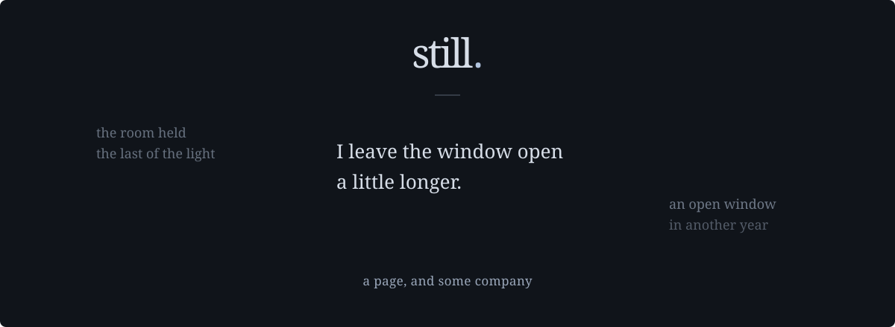

Still is a private, local place to write in the company of old writing.
A poem, a list, a fragment. A title if you want one. Room to begin again.

[Writing & care](docs/guide.md) · [Correspondence](docs/correspondence.md) · [The Mac app](native/NOTES.md)

<br>

### Begin with Now

One blank page. As you write, the controls fall quiet. Your line breaks,
indentation, and spaces stay yours. Save keeps your words as ordinary text files,
with earlier versions to return to.

### Let the past come near

Echoes gather at the edges when your language meets words you have written before.
They listen near the caret, or beside a word you select. Lean toward one and a
little more of its original passage unfolds.

While reading, **Listen here** lets a particular passage draw its own company.
Sometimes the page stays quiet.

### Follow a word

**Threads** follows a recurring word across notebooks and saved pages.
Two passages meet. Open the whole pages, find another crossing, or let another
word find you.

### Make room for what comes next

**Correspondence** holds the life around the work: places to consider, manuscripts
to arrange, submissions to remember, replies to keep. **Then & now** places an
earlier or submitted version beside today's words, so you can see what changed.
Places can suggest saved pieces through shared keywords, keep your own possible
connections, and record your sense of reach with a note.

You decide when the work leaves the room. Still keeps the exact words you sent.

<br>

---

### Yours to keep

Still runs on your computer. No account, cloud API, or analytics.
Echoes follow shared words in your own writing. They offer company, without
inventing an interpretation.

New writing lives in readable text files; historical notebooks remain in their
local database. Earlier words, recovery copies, Trash, and verified database
backups each have their place. The [guide](docs/guide.md) explains how to care
for the whole collection.

### Come in

On a Mac, build the app with Elixir/Erlang, Xcode command-line tools, and Python 3:

```sh
./native/build.sh
open dist/Still.app
```

The built app runs on its own. [Native notes](native/NOTES.md) cover installation
and the remembered writing folder.

For local development:

```sh
mix setup
mix phx.server
```

Open [localhost:4000](http://localhost:4000). For Docker, isolated previews,
storage, recovery, and checks, see [Using Still](docs/guide.md).

<br>

*For the words you are writing, and the ones that stayed.*
